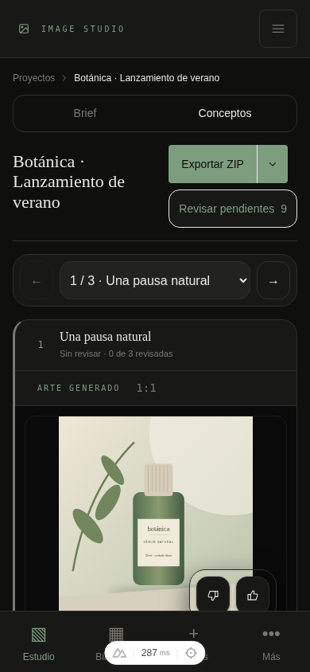
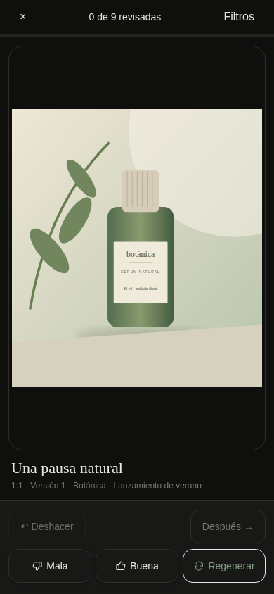
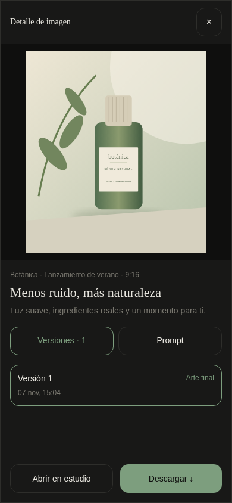

# Validación móvil

La implementación mantiene la generación, las evaluaciones y las reglas de exportación. Adapta la presentación y añade borradores de brief locales. Las capturas usan datos de ejemplo en una copia temporal de SQLite.

## Comprobaciones

- `bun run build`
- `bun run typecheck`
- `bun test --timeout 30000`, con la CLI `sqlite3` disponible para los tests de migraciones. Los tests de backups pueden superar el límite predeterminado de cinco segundos en este entorno.
- Chromium con entrada táctil a 360, 390 y 430 px, y escritorio a 1280 px. Se revisaron las diez rutas principales, sin errores JavaScript ni desbordamiento horizontal.
- Diálogo de revisión a 360 × 640, 390 × 844, 430 × 740 y 1280 × 844. Los controles de evaluación quedan dentro del viewport.
- Evaluar una imagen guarda la decisión; deshacer restaura el contador y la evaluación.
- Guardar un borrador, recargar y recuperarlo conserva el brief.
- Guardar una sección de Ajustes no envía los cambios pendientes de otra sección ni los borra del formulario.
- Abrir y cerrar el detalle de biblioteca restaura el scroll de fondo. El diálogo conserva el selector de versiones y el enlace al estudio.
- Acceso directo a ingeniería inversa sin el anterior error de contexto de Nuxt.

No se realizaron llamadas reales de generación con Gemini, restauraciones destructivas ni pruebas en Safari o en un teléfono físico. El teclado virtual y los selectores de fotos nativos requieren comprobación en dispositivo. Las alturas dinámicas, áreas seguras y tamaño de campos están contemplados en los estilos y el viewport.

## Capturas

